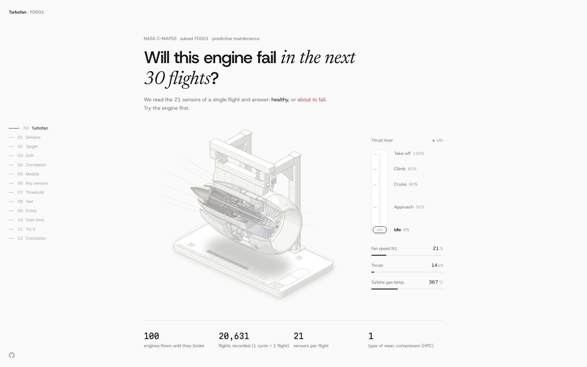
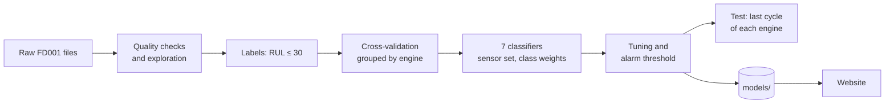

<div align="center">


# NASA C-MAPSS FD001 predictive maintenance

Predicting which turbofan engines have at most 30 cycles of life left, from a single flight's sensor readings.

[Website](https://nasa-c-mapss.hirchyts-daniil.me/) · [Notebook](nasa_fd001_predictive_maintenance.ipynb) · [Report](report/NASA_FD001_Predictive_Maintenance_Technical_Report.pdf) · [Results](#results) · [Run it](#run-the-notebook)

<a href="https://nasa-c-mapss.hirchyts-daniil.me/"></a>

<sub>The companion website, with an interactive engine, the charts behind each step and the trained model running in the browser.</sub>

</div>

## About

FD001 is the first subset of NASA's C-MAPSS turbofan simulation data: 100
engines run until failure in training, 100 engines cut off at an unknown point
in testing, one operating condition and one fault mode (high-pressure compressor
degradation). Each row is one cycle with 3 operational settings and 21 sensors.

The task is framed as binary classification: is the engine within 30 cycles of
failure? The notebook:

- checks the raw files and explores lifetimes, sensors and degradation patterns;
- validates by grouping whole engines, so no engine appears in both training and
  validation folds;
- compares seven classifiers, then tests the sensor set and class weights;
- tunes the models and picks an alarm threshold on training validation only;
- evaluates once on the last recorded cycle of each test engine, with bootstrap
  confidence intervals.

The chosen model is a logistic regression on 14 sensors. It is saved in
[`models/`](models) and reused as is by the website.

## Results

On the 100 test engines (25 of them within 30 cycles of failure), with the alarm
threshold at 0.592:

| Metric | Value | 95% bootstrap interval |
| --- | :---: | :---: |
| Recall | 0.84 (21 of 25) | 0.67 – 0.96 |
| Precision | 0.875 (3 false alarms) | 0.73 – 1.00 |
| F1 | 0.86 | 0.73 – 0.95 |
| ROC AUC | 0.978 | 0.95 – 0.995 |
| Average precision | 0.944 | 0.87 – 0.99 |

Grouped cross-validation on the training engines, after tuning:

| Model | Recall | Precision | F1 | Average precision |
| --- | :---: | :---: | :---: | :---: |
| **Logistic regression** (chosen) | 0.946 | 0.730 | 0.822 | 0.951 |
| Naive Bayes | 0.961 | 0.712 | 0.815 | 0.955 |
| SVM (RBF) | 0.955 | 0.722 | 0.820 | 0.955 |
| Gradient boosting | 0.941 | 0.741 | 0.827 | 0.951 |
| Random forest | 0.900 | 0.812 | 0.852 | 0.948 |
| k-NN | 0.829 | 0.904 | 0.863 | 0.953 |
| Decision tree | 0.939 | 0.690 | 0.794 | 0.908 |

Five models reach an average precision within 0.005 of the best; among those, a
simplicity order fixed in advance picks logistic regression (C = 100, balanced
class weights, standardised inputs). The alarm threshold maximises F2 on
out-of-fold training scores, which weights recall above precision.

## How it works



## Run the notebook

Use Python 3.11–3.13. The versions in `requirements.txt` match the environment
used to verify the notebook.

```bash
python -m pip install -r requirements.txt
```

Open [the notebook](nasa_fd001_predictive_maintenance.ipynb) in a Jupyter-compatible
editor, select that environment, restart the kernel and run all cells from the
repository root. The repeated cross-validation and grid searches take several
minutes.

To execute it and refresh the HTML preview from the command line:

```bash
python -m jupyter nbconvert --execute --to notebook --inplace --ExecutePreprocessor.timeout=900 nasa_fd001_predictive_maintenance.ipynb
python -m jupyter nbconvert --to html nasa_fd001_predictive_maintenance.ipynb
```

The data is included under `cmapss_nasa_turbo_engine_6_data/CMAPSSData/`. The
[HTML preview](nasa_fd001_predictive_maintenance.html) has the same text, tables
and interactive Plotly figures as the notebook.

### Continuing the work

Section 0 holds the warning window, random seeds, fold count, bootstrap count
and CPU parallelism. Sections 1–12 explore the data, section 13 prepares it for
modelling, sections 14–22 train and evaluate, and section 23 lists next
experiments.

For new engineered features, pass a training dataframe containing the features,
`unit` and `y` to `cross_validate(model, features, data=...)`. Compute rolling
features per engine from current and earlier cycles only. Keep feature and
threshold selection on training validation: the test set has already been
inspected. The written interpretations describe the reference configuration;
review them after changing data, features or parameters.

## Repository layout

| Path | Contents |
| --- | --- |
| [`nasa_fd001_predictive_maintenance.ipynb`](nasa_fd001_predictive_maintenance.ipynb) | The full workflow: exploration, modelling, evaluation |
| [`report/`](report) | Technical report (PDF) |
| [`models/`](models) | The chosen model as `joblib` and as JSON (scaler, weights, intercept, threshold) |
| [`website/`](website) | React site presenting the results; [its README](website/README.md) covers building it and regenerating its data |
| `cmapss_nasa_turbo_engine_6_data/` | The C-MAPSS data and NASA's description of it |
| `Project 01 - Predictive Maintenance - 2026-2027.pdf` | The assignment |

## Authors

Daniil Hirchyts, Matteo Louet and Stéphane Singery, for Machine Learning I
(ADIF71) at EFREI Paris, ING2 BDML, 2026–2027.

## Data

The C-MAPSS data comes from the NASA Prognostics Center of Excellence data
repository: A. Saxena, K. Goebel, D. Simon and N. Eklund, *Damage Propagation
Modeling for Aircraft Engine Run-to-Failure Simulation*, PHM 2008. The paper is
included with the data.
